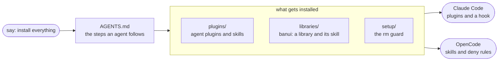

# seymurglv-kit

My working kit in one repository: the things I use with coding agents, kept so that a new computer is one clone
away. Open the folder in an agent, say "install everything", and the working environment is back.



## Contents

```text
seymurglv-kit
├── plugins/      plugins and skills for coding agents
├── libraries/    code libraries
├── setup/        files a machine needs once
├── guides/       how things in this kit are built
├── AGENTS.md     what an agent does on "install everything"
└── README.md
```

Open a folder to see what is inside.

<details>
<summary><b>plugins/</b> &nbsp;·&nbsp; 1 plugin of my own, 3 from their original repositories</summary>

<br>

| Plugin | Claude Code | OpenCode | What it is |
|---|---|---|---|
| [`agent-desktop`](https://github.com/vercel-labs/agent-desktop) | yes | skills | Not kept here: installed from Vercel Labs' own repository. Desktop control through the OS accessibility tree: snapshot an app, act on a ref, re-read to verify. Guides for macOS and Windows |
| [`modern-web-guidance`](https://github.com/GoogleChrome/modern-web-guidance) | yes | skills | Not kept here: installed from Google Chrome's own repository. Before web code is written, the skill searches and retrieves current guides for HTML, CSS and client-side JS; needs Node for `npx` |
| [`taste-skill`](https://github.com/Leonxlnx/taste-skill) | yes | skill | Not kept here: installed from Leonxlnx's own repository. Art direction for websites and landing pages: real photographs and icons, one section per screen, a checker and finish gate in headless Chrome; needs Node 22+ and Chrome |
| [`waypoints`](plugins/waypoints) | yes | no | Up to three likely next prompts as quiet rows above the prompt box after each turn |

</details>

<details>
<summary><b>libraries/</b> &nbsp;·&nbsp; 1 library with a skill for agents</summary>

<br>

| Name | Claude Code | OpenCode | What it is |
|---|---|---|---|
| [`banui`](libraries/banui) | skill | skill | A UI design language where every control is built from five signs (capsule, line, dot, lamp, pen stroke). The library is framework-free TypeScript and CSS with a demo and its tests; the [skill for an agent](libraries/banui/skills/banui) inside it is one hub with four branches (design, implement in React, review, library) and carries the lamp color map, the built library, a ready settings screen, control recipes and a checker |

<p>
  
  
</p>

</details>

<details>
<summary><b>setup/</b> &nbsp;·&nbsp; 1 guard for a new machine</summary>

<br>

| Name | Claude Code | OpenCode | What it is |
|---|---|---|---|
| [`rm guard`](setup) | hook | deny rules | Blocks every command that deletes files; a delete goes to the Trash or Recycle Bin instead, after a yes in chat |

</details>

<details>
<summary><b>guides/</b> &nbsp;·&nbsp; 1 standard</summary>

<br>

| Name | What it is |
|---|---|
| [`skills`](guides/skills) | How a skill in this kit is built: where it lives, its folder, frontmatter, hub and references, checks and evals. With a template to start from and a script that checks a skill against the rules |

</details>

## Install

Open this folder in your agent and say:

> Install everything from this repository.

The agent follows [`AGENTS.md`](AGENTS.md): it finds out which agent and system it runs on, installs what works
there, and checks the result.

<details>
<summary>By hand, in Claude Code</summary>

<br>

```
/plugin marketplace add seymurglv/seymurglv-kit
/plugin install agent-desktop@seymurglv
/plugin install banui@seymurglv
/plugin install modern-web-guidance@seymurglv
/plugin install taste-skill@seymurglv
/plugin install waypoints@seymurglv
```

Then the rm guard from [`setup/`](setup), and a restart.

</details>

<details>
<summary>Only the banui skill, for any agent that reads skills</summary>

<br>

```sh
npx skills add seymurglv/seymurglv-kit --skill banui
```

</details>

## Adding something

One thing is one folder with its own README, plus one row in its section above.

| Folder | For |
|---|---|
| `plugins/` | plugins and skills for agents; a Claude Code plugin also gets an entry in `.claude-plugin/marketplace.json` |
| `libraries/` | code libraries |
| `setup/` | files a machine needs once: hooks, settings |
| `guides/` | how things here are built: a standard, its template and its check |

A new skill follows [`guides/skills`](guides/skills).

## Notes

- The steps were run on macOS. The Windows steps in `AGENTS.md` have not been run yet.
- In OpenCode the deny rules were written and parse; a refused `rm` in a live OpenCode chat has not been seen yet.
- `waypoints` draws in Claude Code's own interface, so it stays Claude Code only.
