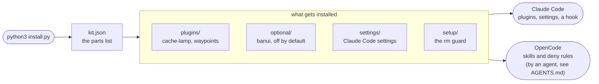
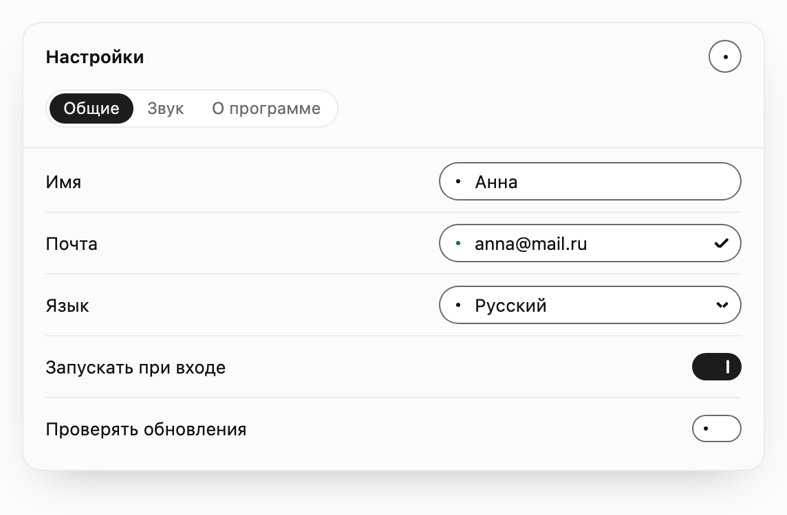
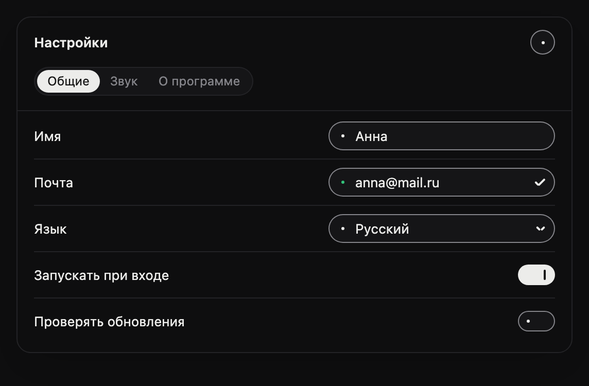

# seymurglv-kit

My working kit in one repository: the things I use with coding agents, kept so that a new computer is one clone
away. Run one command, tick what you want, and the working environment is back.



## Contents

```text
seymurglv-kit
├── install.py        the installer (a menu, or flags)
├── kit.json          the list of parts
├── plugins/          cache-lamp, waypoints
├── optional/banui/   the banui library and skill, off by default
├── settings/         claude.json: the Claude Code settings it carries
├── setup/            the rm guard
├── guides/           how things in this kit are built
├── tests/            tests of install.py
├── AGENTS.md         what an agent does when asked to install
└── README.md
```

Open a section to see what is inside.

<details>
<summary><b>plugins/</b> &nbsp;·&nbsp; 2 plugins of my own, 1 from its original repository</summary>

<br>

| Plugin | Part id | Claude Code | OpenCode | What it is |
|---|---|---|---|---|
| [`cache-lamp`](plugins/cache-lamp) | `cache-lamp` | yes | no | A lamp above the prompt box for the state of the session's prompt cache, and a quiet ping that keeps a big cache warm while you are away |
| [`taste-skill`](https://github.com/Leonxlnx/taste-skill) | `taste-skill` | yes | skill | Not kept here: installed from Leonxlnx's own repository. Art direction for websites and landing pages: real photographs and icons, one section per screen, a checker and finish gate in headless Chrome; needs Node 22+ and Chrome |
| [`waypoints`](plugins/waypoints) | `waypoints` | yes | no | Up to three likely next prompts as quiet rows above the prompt box after each turn |

</details>

<details>
<summary><b>optional/</b> &nbsp;·&nbsp; 1 library with a skill for agents, off by default</summary>

<br>

| Name | Part id | Claude Code | OpenCode | What it is |
|---|---|---|---|---|
| [`banui`](optional/banui) | `banui` | skill | skill | A UI design language where every control is built from five signs (capsule, line, dot, lamp, pen stroke). The library is framework-free TypeScript and CSS with a demo and its tests; the [skill for an agent](optional/banui/skills/banui) inside it is one hub with four branches (design, implement in React, review, library) and carries the lamp color map, the built library, a ready settings screen, control recipes and a checker |

The menu leaves banui unticked. Install it with `--only banui` or `--all`.

<p>
  
  
</p>

</details>

<details>
<summary><b>setup/</b> and <b>settings/</b> &nbsp;·&nbsp; the rm guard and the carried settings</summary>

<br>

| Name | Part id | Claude Code | OpenCode | What it is |
|---|---|---|---|---|
| [`rm guard`](setup) | `rm-guard` | hook | deny rules | Blocks every command that deletes files; a delete goes to the Trash or Recycle Bin instead, after a yes in chat |
| [`settings`](settings/claude.json) | `settings` | yes | no | The Claude Code settings this kit carries, merged into `~/.claude/settings.json` (list below) |

</details>

<details>
<summary><b>guides/</b> &nbsp;·&nbsp; 1 standard</summary>

<br>

| Name | What it is |
|---|---|
| [`skills`](guides/skills) | How a skill in this kit is built: where it lives, its folder, frontmatter, hub and references, checks and evals. With a template to start from and a script that checks a skill against the rules |

</details>

## Install

Clone the repository and run the installer. It needs Python 3 and the `claude` command, nothing else.

```sh
python3 install.py
```

In a terminal this shows a checklist. Move with the arrow keys, tick with space, install with Enter, quit with `q`.
Everything is ticked except banui.

For repeat runs and for agents there are flags:

| Flag | What it does |
|---|---|
| `--all` | every part, banui included |
| `--only a,b` | only these parts, by id: `cache-lamp`, `waypoints`, `taste-skill`, `banui`, `rm-guard`, `settings` |
| `--skip a,b` | all default parts except these |
| `--dry-run` | prints every step and changes nothing |
| `--list` | the parts, and whether each is installed |
| `--local` | register this clone as the marketplace instead of the GitHub repository, to test before a push |
| `--force-settings` | overwrite a setting you changed yourself (by default your value is kept) |

Without a terminal and without `--all`, `--only` or `--skip` it refuses and says so.

The installer is safe to repeat. Before it writes `~/.claude/settings.json` it copies the file to
`settings.before-kit-<date>.json` next to it. It merges into what is there and never replaces it; a second run with
the same picks changes nothing.

Or open this folder in an agent and say "install this kit": it follows [`AGENTS.md`](AGENTS.md), which runs the same
installer.

<details>
<summary>Settings it carries</summary>

<br>

The `settings` part merges [`settings/claude.json`](settings/claude.json) into `~/.claude/settings.json`:

- `permissions.allow`, so these run without a prompt: Bash patterns for `python3`, `git status`, `git diff`,
  `git log`, `git show`, `git ls-files`, `git check-ignore`, `git add`, `git commit`, `node`, `npm run`, `ffmpeg`,
  `ffprobe`, `sed`, `awk`, `sort`, `mkdir`, `cp`, `mv`, `touch` and `tee`; `WebSearch`; `WebFetch` for
  `support.google.com` and `code.claude.com` only; `ArtifactData`.
- The `cc-status` hooks for iTerm2, only when iTerm2's `cc-status` exists on the machine.
- `includeCoAuthoredBy`, `outputStyle`, `autoUpdatesChannel`, `tui`, `theme`, `skipWorkflowUsageWarning`,
  `switchModelsOnFlag`, `agentPushNotifEnabled`, and `autoMode.soft_deny` (written only if it is absent).
- The `seymurglv` marketplace in `extraKnownMarketplaces`.
- With each plugin part: its `enabledPlugins` entry and its `pluginConfigs` (the lamp and waypoints speak Russian).

A setting you already changed is kept, and the installer prints `kept yours: theme=dark (kit: auto)`.

Never carried: the auto-mode `environment` text, any personal path, the global `~/.claude/CLAUDE.md`, keys,
`permissions.defaultMode`, `statusLine`, and `cc-plugin-you-should-know@builtin`.

</details>

<details>
<summary>By hand, in Claude Code</summary>

<br>

```
/plugin marketplace add seymurglv/seymurglv-kit
/plugin install cache-lamp@seymurglv
/plugin install waypoints@seymurglv
/plugin install taste-skill@seymurglv
/plugin install banui@seymurglv
```

Then the rm guard from [`setup/`](setup), and a restart.

</details>

<details>
<summary>Only the banui skill, for any agent that reads skills</summary>

<br>

```sh
npx skills add seymurglv/seymurglv-kit --skill banui
```

</details>

## Adding something

One thing is one folder with its own README, plus one row in its section above. A new installable part also gets
an entry in `kit.json`.

| Folder | For |
|---|---|
| `plugins/` | plugins and skills for agents; a Claude Code plugin also gets an entry in `.claude-plugin/marketplace.json` |
| `optional/` | things that are not installed by default, such as a code library |
| `setup/` | files a machine needs once: hooks |
| `settings/` | the settings fragment the installer merges |
| `guides/` | how things here are built: a standard, its template and its check |

A new skill follows [`guides/skills`](guides/skills).

## Notes

- The steps were run on macOS. The Windows steps in `AGENTS.md` have not been run yet.
- In OpenCode the deny rules were written and parse; a refused `rm` in a live OpenCode chat has not been seen yet.
- `waypoints` and `cache-lamp` draw in Claude Code's own interface, so they stay Claude Code only.
