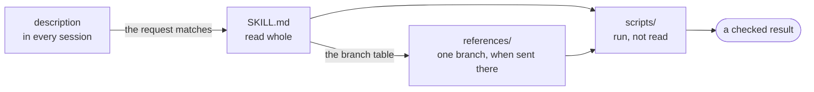

# Skills: the standard of this kit

How a skill in this repository is built, so that every next one is built the same way. A skill is a folder
with a `SKILL.md` that teaches an agent one job. The rules below come from the Agent Skills specification,
Anthropic's authoring guidance and the way the strongest public skills are laid out (sources at the end).

[`check-skill.mjs`](check-skill.mjs) checks the rules marked **checked**. [`template/`](template) is a
skill to start from. [`libraries/banui/skills/banui`](../../libraries/banui/skills/banui) is the worked example.

An agent pays for a skill in three steps, and each step is read only when the one before it asks:



## Contents

- Where a skill lives
- The folder
- One skill or several
- Frontmatter
- SKILL.md
- References
- Scripts and checks
- Evals
- Starting a new skill
- Sources

## Where a skill lives

| The skill | Folder | Also |
|---|---|---|
| Stands alone, or belongs to a plugin of mine | `plugins/<plugin>/skills/<skill>/` | an entry in `.claude-plugin/marketplace.json` |
| Teaches a library kept here | `libraries/<library>/skills/<skill>/` | the same entry, with the library folder as the plugin |
| Someone else's | not copied | a marketplace entry that points at its original repository |

The folder name is the skill's `name`. Skills lie flat in `skills/`: no skill inside another skill.

## The folder

```text
<skill>/
├── SKILL.md         the hub: the rules that always hold, and where to read next
├── references/      one file per branch or domain, read only when the hub sends there
├── scripts/         checks and tools the agent runs instead of reasoning
├── examples/        finished work to copy from
├── assets/          files the result is built with: templates, fonts, a built library
└── evals/           evals.json (tasks) and triggers.json (when the skill should load)
```

Only `SKILL.md` and `evals/` are required. A folder exists when it has something in it. A folder that a
build writes (a copy of a library, a generated table) says so in `SKILL.md` and is never edited by hand.

## One skill or several

**One job, one skill.** Its branches (design, implement, review) are reference files that the hub routes
to through a table. A branch costs nothing until it is read; a separate skill costs a description in every
session and can load in place of its neighbour.

Make a second skill only when it has a different trigger and can do its work without the first. If it
needs the first, it is a branch. Two skills that do depend on each other say so in words in their bodies
("read the `x` skill first"); there is no other mechanism.

## Frontmatter

```yaml
---
name: skill-name
description: What the skill covers, then when to use it.
---
```

- `name`: lowercase letters, digits and single hyphens, at most 64 characters, the same as the folder. **checked**
- `description`: 1 to 1024 characters, no angle brackets. **checked**
- Only `name`, `description`, `license`, `compatibility`, `metadata` and `allowed-tools`. Fields that one
  agent alone understands break the skill in the others. **checked**

The description is all an agent sees before it decides to load the skill:

- Say what the skill covers and when to use it: the tasks, the words a person would use, the symptoms.
- Third person. No "I" and no "you".
- Never the steps. An agent that reads the workflow in the description follows that summary and skips the body.
- Name the near misses the skill is not for when a neighbour could be confused with it.

## SKILL.md

- Under 500 lines. **checked** Shorter is better: every line is paid for each time the skill loads.
- The rules that must never be broken come first. After a long session only the top of a skill is kept.
- Then the routing table: what the person wants, and which files to read for it, in order.
- Then the check that ends every branch.
- Give one way to do a thing, not a menu. Use one word for one thing throughout.
- Say only what an agent would get wrong without being told. No history, no dates, nothing that goes stale.
- A value that lives in code (a token, a size) is copied from the code and kept true by a test, or not written at all.

## References

- Every file in `references/` is linked from `SKILL.md`. **checked**
- A reference does not link to another reference: the hub lists everything a branch needs. **checked**
- A reference over 100 lines opens with a `## Contents` list. **checked**
- Links are relative, with forward slashes, and point at files that exist. **checked**
- One file per branch (a playbook: numbered steps to the result) or per domain (recipes, tables).

## Scripts and checks

- A rule that a pattern can catch is a script, not a sentence. Prose is for judgment.
- A script takes paths as arguments, prints `file:line  rule  what to do`, and exits 1 when it found something.
- The last step of every branch runs the check. Each hit is fixed, or shown to the person with the reason it stays.
- No dependencies to install: plain Node or Python.

## Evals

Written before the skill's text, so the text answers real failures.

- `evals/evals.json`: at least three tasks. **checked** Each has a prompt and the facts a good answer shows.
- `evals/triggers.json`: requests that must load the skill and near misses that must not.
- To judge a change, give the same task to a fresh agent with the skill and without it, and compare.

## Starting a new skill

1. Copy [`template/`](template) to its place under the new name, and rename `SKILL.template.md` to `SKILL.md`.
2. Write three tasks in `evals/evals.json`. Give one to an agent that has no skill and note what it gets wrong.
3. Write `SKILL.md` against those mistakes. Move what only one branch needs into `references/`.
4. Turn every rule a pattern can catch into `scripts/`.
5. Run `node guides/skills/check-skill.mjs <folder>` until it prints nothing.
6. Give the tasks to a fresh agent with the skill. Fix what it still gets wrong.
7. Add the marketplace entry, the row in the root `README.md`, and the row in `AGENTS.md` for OpenCode.

`node guides/skills/check-skill.mjs` with no arguments checks every skill kept in this repository.

## Sources

- Agent Skills specification: <https://agentskills.io/specification>
- Anthropic, skill authoring best practices: <https://platform.claude.com/docs/en/agents-and-tools/agent-skills/best-practices>
- Claude Code, skills and plugins: <https://code.claude.com/docs/en/skills>, <https://code.claude.com/docs/en/plugins-reference>
- Layouts studied: `anthropics/skills`, `obra/superpowers`, `pbakaus/impeccable`, `Leonxlnx/taste-skill`, `shadcn-ui/ui`, `vercel-labs/agent-skills`, `figma/mcp-server-guide`
