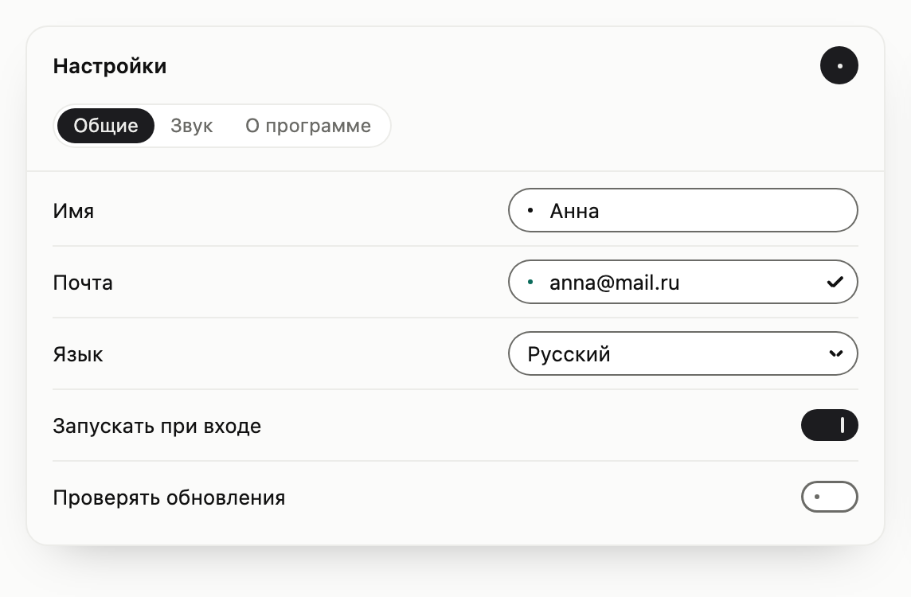
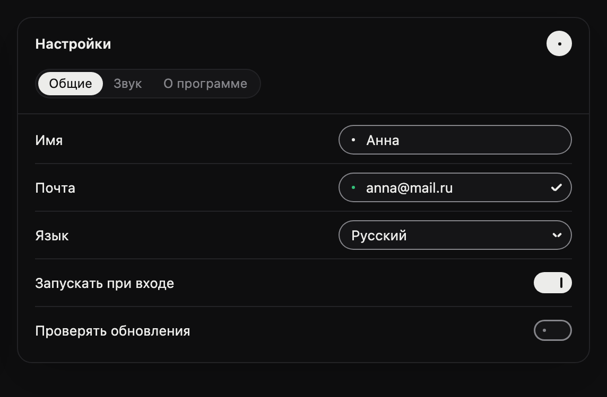

# banui

Тихий интерфейс, в котором каждый контрол собран из пяти знаков: капсулы, линии, точки, лампы и штриха ручки. Состояние не рисуется заново, а ставит те же линии в новое положение: точка вытягивается в линию, линии складываются в галочку, капсула едет к выбранному разделу. Библиотека без зависимостей: один файл стилей и модули на TypeScript, которые достраивают знаки к обычной разметке.

<p>
  
  
</p>

## Пять знаков

| Знак | Что значит | Геометрия |
|---|---|---|
| Капсула | контейнер и то, что выбрано | радиус равен половине высоты |
| Линия | включено, идёт действие | скруглённый штрих толщиной 2 px |
| Точка | покой, выключено | круг 3 px |
| Лампа | сигнал | та же точка 3 px, только зажжённая; один цвет на один смысл |
| Штрих ручки | «посмотри сюда» | рукописная линия 1,75 px цвета ручки |

Залитая капсула значит «включено» или «выбрано», обведённая значит «выключено» или «не выбрано». Точка и линия — один элемент `.ban-ln`, поэтому одна перетекает в другую.

## Карта ламп

| Смысл | `data-kind` | На залитой капсуле | На карточке | Что стоит рядом с цветом |
|---|---|---|---|---|
| Готово | `done` | `#33C27A` | `#0B6B5B` | галочка |
| Ошибка | `error` | `#F5B82E` | `#BD7313` | штрих ручки под неверным и слова, что не так |
| Запись | `rec` | `#FF5A2E` | `#9E1708` | волна линий |
| Внимание | `attention` | `#5C8DFF` | `#2F6BFF` | лампа дышит, пока на неё не посмотрят |

Значения для светлой темы; в тёмной два столбца меняются местами. Цвет никогда не говорит один, рядом всегда знак или слова. Ошибка янтарная, потому что красный значит запись.

## Как подключить

1. Соберите библиотеку (`npm run build`) и скопируйте всю папку `dist/` рядом со страницей, например под именем `banui/`. Копируется папка целиком: `index.js` подключает соседние модули, а `banui.css` берёт шрифты из `fonts/`.
2. Подключите `banui/banui.css` и оберните страницу в `.ban`.
3. Напишите по одному элементу на контрол с классом `ban-*`. До запуска скрипта он уже имеет свой размер, знаки достраиваются без сдвига вёрстки.
4. Вызовите `mount()` из `banui/index.js`: он достроит все контролы на странице. Повторный вызов ничего не удваивает.

```html
<link rel="stylesheet" href="banui/banui.css">
<style>
  .win { position: relative; max-width: 480px; padding: 48px 16px 16px; }
  .row { display: flex; align-items: flex-start; justify-content: space-between; gap: 12px; padding: 8px 0; }
  .row > label { line-height: 28px; }
  /* Ширина задаётся родителю: поле и список занимают его целиком. */
  .control { flex: none; width: 220px; }
  /* Поле с ошибкой оставляет под собой место для пометки. */
  .row:has(.ban-field-box[data-state="error"]) { padding-bottom: 29px; }
</style>

<main class="ban">
  <div class="win">
    <div class="ban-drop"></div>
    <div class="row">
      <label for="mail">Почта</label>
      <div class="control"><input class="ban-field" id="mail" value="anna@mail.ru"></div>
    </div>
    <div class="row">
      <label for="lang">Язык</label>
      <div class="control">
        <select class="ban-select" id="lang">
          <option value="ru">Русский</option>
          <option value="en">English</option>
        </select>
      </div>
    </div>
    <div class="row">
      <label for="updates">Проверять обновления</label>
      <button class="ban-toggle" id="updates" type="button" role="switch" aria-checked="true"></button>
    </div>
  </div>
</main>

<script type="module">
  import { mount, field, drop } from './banui/index.js'

  mount()
  // Повторный вызов с настройками даёт уже достроенному полю проверку.
  field(document.querySelector('#mail'), {
    confirm: true,
    validate: value => (value.includes('@') ? null : 'нужна @'),
  })

  const status = drop(document.querySelector('.ban-drop'))
  document.querySelector('#lang').addEventListener('ban:change', () => {
    status.show('attention', 'Сменится после перезапуска')
  })
</script>
```

Пометка ошибки рисуется под полем и места в вёрстке не занимает: пока поле в ошибке, страница оставляет под ним около 21 px (в окне настроек строка с полем растёт с 45 до 66 px). Поле и список достраиваются в `.ban-field-box` и `.ban-select-box`, блочные и во всю ширину родителя, поэтому ширину задают родителю, а не самому `<input>` или `<select>`.

Каждая функция возвращает контроллер; повторный вызов на том же элементе возвращает тот же контроллер, а `destroy()` убирает всё, что функция достроила; после `destroy()` старый контроллер больше ничего не меняет. События — `CustomEvent`, всплывают и сообщают о том, что сделал человек. Присваивание из кода (`checked`, `value`, `index`) меняет состояние молча. Исключения: `show()`, `think()` и `rest()` капли и `check()` поля сообщают `ban:change` и при вызове из кода.

## Контролы

| Класс | Что написать | Функция | Что сообщает |
|---|---|---|---|
| `ban-toggle` | `<button role="switch" aria-checked="false">` | `toggle(el)`: `checked` | `ban:change`, `detail.checked` |
| `ban-field` | `<input>` | `field(input, { validate, confirm })`: `state`, `box`, `check()`, `setError()` | `ban:change` после проверки (уход фокуса, Enter), только когда значение или состояние изменилось: `detail.value`, `detail.state` |
| `ban-select` | `<select>` с `<option>` и `aria-label` или `<label>` | `select(el)`: `value`, `open`, `show()`, `hide()` | `change` и `ban:change`: `detail.value`, `detail.label` |
| `ban-nav` | `<div role="tablist">` с `<button role="tab" aria-controls="…">`; разделы `role="tabpanel"` в общем родителе, невыбранные с `hidden` | `nav(el)`: `index`, `select(i)` | `ban:change`: `detail.index`, `detail.id` |
| `ban-drop` | пустой `<div>` в окне с `position: relative`; имя крестика в `data-close-label`, по умолчанию «Закрыть» | `drop(el)`: `state`, `show(kind, text)`, `think()`, `rest()` | `ban:change` при смене состояния (`detail.state`), `ban:open` по нажатию на текст, `ban:close` по крестику |
| `ban-button` | `<button class="ban-button" tabindex="0">` | не нужна, только стили; `mount()` ставит `tabindex="0"` сам, без `mount()` напишите его | обычный `click` |

`validate` получает значение и возвращает `null` или короткую причину; причина появляется рукописной пометкой под полем. `confirm: true` ставит галочку и лампу «готово» верному значению. `field()` можно вызвать и после `mount()`: вызов с настройками заменяет `validate` и `confirm` у того же контроллера, вызов без настроек ничего не меняет. `toggle()` ставит `role="switch"` и `aria-checked="false"` кнопке, у которой их нет.

Список рассчитан на короткие перечни: он раскрывается на все строки сразу, без прокрутки. Варианты читаются один раз, когда контрол строится. Отключённый `<select>` не открывается, отключённые `<option>` нельзя выбрать, стрелки их пропускают. Нажатие на его `<label>` ставит фокус на кнопку значения и список не раскрывает; сброс формы возвращает подпись.

Капля показывает одно сообщение за раз и не закрывается сама; когда окно сужается, сообщение подстраивается под новую ширину.

Ещё модуль отдаёт `morphLabel(el, text)` (подпись меняется по общим буквам), `followHeight(box, change)` (высота следует за содержимым) и `textWidth(el, text)` (ширина текста в шрифте элемента; элемент должен быть в документе и со стилями).

## Темы

`data-theme="light"` или `data-theme="dark"` на любом предке задаёт тему его поддерева; элемент с `data-theme` внутри `.ban` получает свой фон и цвет текста. Без атрибута тема следует системной. Смена темы после достройки подхватывается сразу.

## Движение

Ничто не движется без причины: только нажатие или пришедшие данные; сами по себе дышат лишь лампа «внимание» и три точки «думаю».

При `prefers-reduced-motion: reduce` переходы и дыхание выключены, подписи меняются сразу, а состояния меняются как обычно.

## Скилл

Вместе с библиотекой лежит скилл для агента, [`skills/banui/SKILL.md`](skills/banui/SKILL.md): правила языка, собранная библиотека и референсы. У него четыре режима. Если из просьбы неясно, какой нужен, агент один раз спрашивает.

| Режим | Что вы говорите | Что делает агент |
|---|---|---|
| Создать | описываете, что нужно: экран, контрол, состояние | строит новое по правилам языка, начиная с ближайшего референса |
| Добавить референс | «добавь в референсы», «сохрани как пример» | кладёт в скилл готовую работу, которую вы приняли |
| Обновить референс | «обнови референс» | показывает, что изменится, и правит только этот референс |
| Удалить референс | «удали пример» | называет, что уходит, ждёт вашего «да» и переносит папку в Корзину |

Референс — готовая работа, которую следующий агент берёт за основу. Экран хранится папкой в `skills/banui/examples/`, контрол — разделом в `skills/banui/references/controls.md`. Папка `kit/` референсом не считается: её пишет `npm run build`.

Правила языка, токены и значения при работе с референсами не меняются: это отдельное решение владельца.

## Команды

```sh
npm run dev        # http://127.0.0.1:5179: образцы знаков /demo/specimen.html, пример /skills/banui/examples/screen-settings/index.html
npm run test:unit  # модульные проверки
npm run test:e2e   # проверки в браузерах
npm run build      # dist/ и её точная копия в skills/banui/kit/: модули, объявления типов, banui.css и шрифты
npm run shots      # снимки окна настроек в assets/
```

## Устройство

```
src/
  tokens.css         цвета, шрифты, время
  signs.css          корень .ban, капсула, линия-точка, лампа, фокус
  pen/               штрих ручки и рукописная пометка
  controls/          toggle, field, select, nav, drop, button
  primitives.css     примитивы для страниц, собранных из знаков вручную
  fonts/             Caveat 600 и его лицензия
  motion.ts          смена подписи, высота, ширина текста
  index.ts           вход и mount()
  banui.css          собирает всё вместе
demo/                образцы знаков
tests/               модульные и браузерные проверки
scripts/             сборка стилей, копия сборки в kit/ и снимки
skills/banui/        правила языка для агента
  kit/               собранная библиотека, копия dist/; её пишет build
  examples/          готовые примеры; папка примера вместе с kit/ копируется как есть
  references/        рецепты контролов и глифов
assets/              снимки для этого файла
```

Пока нет: флажка, счётчика, ползунка, кнопки состояния, поиска, лотка и остальных пометок ручки.
