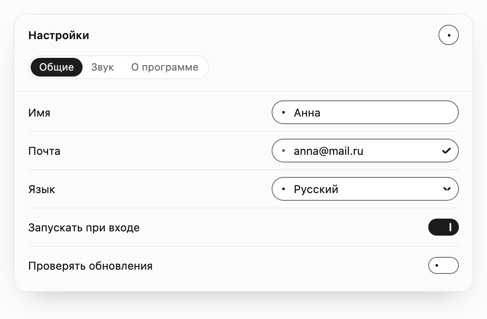
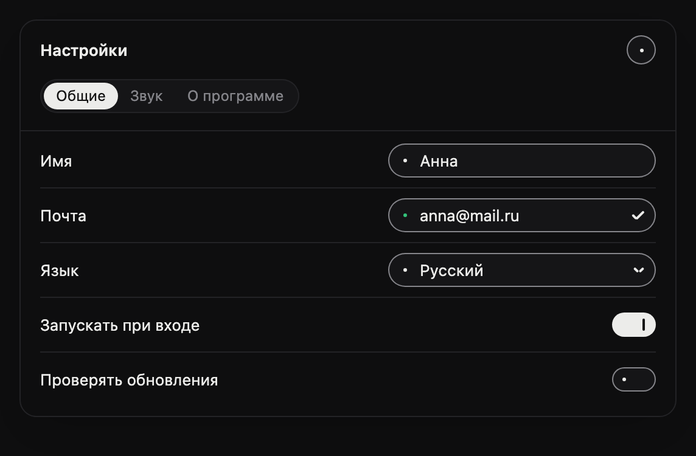

# banui

A quiet interface where every control is built from five signs: capsule, line, dot, lamp and pen stroke. A state is not drawn anew, it puts the same lines in a new position: a dot stretches into a line, lines fold into a check, a capsule travels to the chosen section.

Two things live in this folder:

- **The library**: one stylesheet and TypeScript modules with no dependencies, which build the signs onto plain markup.
- **The skill**: the rules of the language for a coding agent, with the built library, a ready settings screen and control recipes.

<p>
  
  
</p>

## Contents

- [The five signs](#the-five-signs)
- [Lamp map](#lamp-map)
- [Install](#install)
- [Use the library on a page](#use-the-library-on-a-page)
- [Controls](#controls)
- [Themes](#themes)
- [Motion](#motion)
- [The skill](#the-skill)
- [Commands](#commands)
- [Layout](#layout)

## The five signs

| Sign | Means | Geometry |
|---|---|---|
| Capsule | a container, and what is selected | radius equals half its height |
| Line | on, an action is running | a rounded stroke 2 px thick |
| Dot | rest, off | a 3 px circle |
| Lamp | a signal | the same 3 px dot, lit; one color for one meaning |
| Pen stroke | "look here" | a handwritten line 1.75 px thick, in the pen color |

A filled capsule means "on" or "selected", an outlined one means "off" or "not selected". Dot and line are one element, `.ban-ln`, so one flows into the other.

## Lamp map

| Meaning | `data-kind` | On a filled capsule | On a card | What stands next to the color |
|---|---|---|---|---|
| Done | `done` | `#33C27A` | `#0B6B5B` | a check |
| Error | `error` | `#F5B82E` | `#BD7313` | a pen stroke under what is wrong, and words that say why |
| Recording | `rec` | `#FF5A2E` | `#9E1708` | a wave of lines |
| Attention | `attention` | `#5C8DFF` | `#2F6BFF` | the lamp breathes until it is looked at |

The values are for the light theme; in the dark theme the two columns swap. Color never speaks alone: a sign or words always stand next to it. Error is amber because red means recording.

## Install

The skill, as a Claude Code plugin:

```
/plugin marketplace add seymurglv/seymurglv-kit
/plugin install banui@seymurglv
```

The skill alone, for any agent that reads skills:

```sh
npx skills add seymurglv/seymurglv-kit --skill banui
```

The library is not published to npm: build it here (`npm install`, then `npm run build`) and copy `dist/`, as the next section describes.

## Use the library on a page

1. Build the library (`npm run build`) and copy the whole `dist/` folder next to the page, for example as `banui/`. Copy the folder as a whole: `index.js` imports its neighbours, and `banui.css` takes its fonts from `fonts/`.
2. Link `banui/banui.css` and wrap the page in `.ban`.
3. Write one element per control with its `ban-*` class. It has its size before the script runs, so the signs are built without a layout shift.
4. Call `mount()` from `banui/index.js`: it builds every control on the page. A second call doubles nothing.

```html
<link rel="stylesheet" href="banui/banui.css">
<style>
  .win { position: relative; max-width: 480px; padding: 48px 16px 16px; }
  .row { display: flex; align-items: flex-start; justify-content: space-between; gap: 12px; padding: 8px 0; }
  .row > label { line-height: 28px; }
  /* The width is given to the parent: a field and a list fill it. */
  .control { flex: none; width: 220px; }
  /* A field with an error keeps room under itself for the note. */
  .row:has(.ban-field-box[data-state="error"]) { padding-bottom: 29px; }
</style>

<main class="ban">
  <div class="win">
    <div class="ban-drop"></div>
    <div class="row">
      <label for="mail">Mail</label>
      <div class="control"><input class="ban-field" id="mail" value="anna@example.com"></div>
    </div>
    <div class="row">
      <label for="lang">Language</label>
      <div class="control">
        <select class="ban-select" id="lang">
          <option value="en">English</option>
          <option value="ru">Русский</option>
        </select>
      </div>
    </div>
    <div class="row">
      <label for="updates">Check for updates</label>
      <button class="ban-toggle" id="updates" type="button" role="switch" aria-checked="true"></button>
    </div>
  </div>
</main>

<script type="module">
  import { mount, field, drop } from './banui/index.js'

  mount()
  // A second call with options gives the field that is already built its check.
  field(document.querySelector('#mail'), {
    confirm: true,
    validate: value => (value.includes('@') ? null : 'needs @'),
  })

  const status = drop(document.querySelector('.ban-drop'))
  document.querySelector('#lang').addEventListener('ban:change', () => {
    status.show('attention', 'Changes after a restart')
  })
</script>
```

The error note is drawn under the field and takes no room in the layout: while the field is in error, the page keeps about 21 px under it (in the settings window the row with the field grows from 45 to 66 px). A field and a list are built into `.ban-field-box` and `.ban-select-box`, block-level and as wide as the parent, so the width is given to the parent, not to the `<input>` or `<select>` itself.

Every function returns a controller; a second call on the same element returns the same controller, and `destroy()` takes away everything the function built; after `destroy()` the old controller changes nothing. Events are `CustomEvent`s, they bubble and report what the person did. An assignment from code (`checked`, `value`, `index`) changes the state silently. The exceptions: the drop's `show()`, `think()` and `rest()` and the field's `check()` report `ban:change` when called from code too.

## Controls

| Class | What to write | Function | What it reports |
|---|---|---|---|
| `ban-toggle` | `<button role="switch" aria-checked="false">` | `toggle(el)`: `checked` | `ban:change`, `detail.checked` |
| `ban-field` | `<input>` | `field(input, { validate, confirm })`: `state`, `box`, `check()`, `setError()` | `ban:change` after a check (focus leaves, Enter), only when the value or the state changed: `detail.value`, `detail.state` |
| `ban-select` | `<select>` with `<option>`s and an `aria-label` or a `<label>` | `select(el)`: `value`, `open`, `show()`, `hide()` | `change` and `ban:change`: `detail.value`, `detail.label` |
| `ban-nav` | `<div role="tablist">` with `<button role="tab" aria-controls="…">`; the sections are `role="tabpanel"` in a shared parent, the unselected ones `hidden` | `nav(el)`: `index`, `select(i)` | `ban:change`: `detail.index`, `detail.id` |
| `ban-drop` | an empty `<div>` in a window with `position: relative`; the name of the cross in `data-close-label`, "Закрыть" by default | `drop(el)`: `state`, `show(kind, text)`, `think()`, `rest()` | `ban:change` when the state changes (`detail.state`), `ban:open` on a press on the text, `ban:close` on the cross |
| `ban-button` | `<button class="ban-button" tabindex="0">` | none needed, styles only; `mount()` sets `tabindex="0"` itself, without `mount()` write it | a plain `click` |

`validate` takes the value and returns `null` or a short reason; the reason appears as a hand note under the field. `confirm: true` gives a valid value a check and the "done" lamp. `field()` can be called after `mount()` too: a call with options replaces `validate` and `confirm` on the same controller, a call without options changes nothing. `toggle()` sets `role="switch"` and `aria-checked="false"` on a button that lacks them.

The list is made for short sets: it opens to all its rows at once, with no scrolling. The options are read once, when the control is built. A disabled `<select>` does not open, disabled `<option>`s cannot be chosen, and the arrow keys skip them. A press on its `<label>` moves focus to the value button and does not open the list; a form reset brings the label back.

The status drop shows one message at a time and does not close by itself; when the window narrows, the message fits the new width.

The module also gives `morphLabel(el, text)` (a label changes by its shared letters), `followHeight(box, change)` (a height follows its content) and `textWidth(el, text)` (the width of a text in the element's font; the element has to be in the document, with its styles).

## Themes

`data-theme="light"` or `data-theme="dark"` on any ancestor sets the theme of its subtree; an element with `data-theme` inside `.ban` gets its own background and text color. Without the attribute the theme follows the system. A theme change after the controls are built is picked up at once.

## Motion

Nothing moves without a cause: only a press or data that arrived. Only the "attention" lamp and the three "thinking" dots breathe by themselves.

With `prefers-reduced-motion: reduce` transitions and breathing are off and labels change at once; states change as usual.

## The skill

Next to the library lies a skill for an agent, [`skills/banui/SKILL.md`](skills/banui/SKILL.md): the rules of the language, the built library and the references. It has four modes. When a request does not say which one is meant, the agent asks once.

| Mode | What you say | What the agent does |
|---|---|---|
| Create | what you need: a screen, a control, a state | builds it new by the rules of the language, starting from the closest reference |
| Add a reference | "add this to the references", "save this as an example" | stores finished work you have accepted in the skill |
| Update a reference | "update the reference" | shows what will change and edits only that reference |
| Delete a reference | "delete the example" | names what goes, waits for your yes and moves the folder to the Trash |

A reference is finished work the next agent starts from. A screen is kept as a folder in `skills/banui/examples/`, a control as a section in `skills/banui/references/controls.md`. The `kit/` folder is not a reference: `npm run build` writes it.

The rules of the language, its tokens and its values do not change while references are worked on: that is a separate decision of the owner.

## Commands

```sh
npm run dev        # http://127.0.0.1:5179: sign samples at /demo/specimen.html, the example at /skills/banui/examples/screen-settings/index.html
npm run test:unit  # unit checks
npm run test:e2e   # checks in browsers
npm run build      # dist/ and its exact copy in skills/banui/kit/: modules, type declarations, banui.css and fonts
npm run shots      # screenshots of the settings window into assets/
```

## Layout

```
.claude-plugin/      the plugin manifest for Claude Code
src/
  tokens.css         colors, fonts, timings
  signs.css          the .ban root, capsule, line and dot, lamp, focus
  pen/               pen stroke and hand note
  controls/          toggle, field, select, nav, drop, button
  primitives.css     primitives for pages put together from the signs by hand
  fonts/             Caveat 600 and its license
  motion.ts          label change, height, text width
  index.ts           the entry and mount()
  banui.css          brings it all together
demo/                sign samples
showcase/            a page that shows the examples side by side
tests/               unit and browser checks
scripts/             the stylesheet build, the copy of the build into kit/, and screenshots
skills/banui/        the rules of the language for an agent
  kit/               the built library, a copy of dist/; build writes it
  examples/          finished examples; an example's folder is copied as it is, together with kit/
  references/        recipes for controls and glyphs
assets/              screenshots for this file
```

Not here yet: a checkbox, a stepper, a slider, a status button, search, a tray and the other pen marks.
